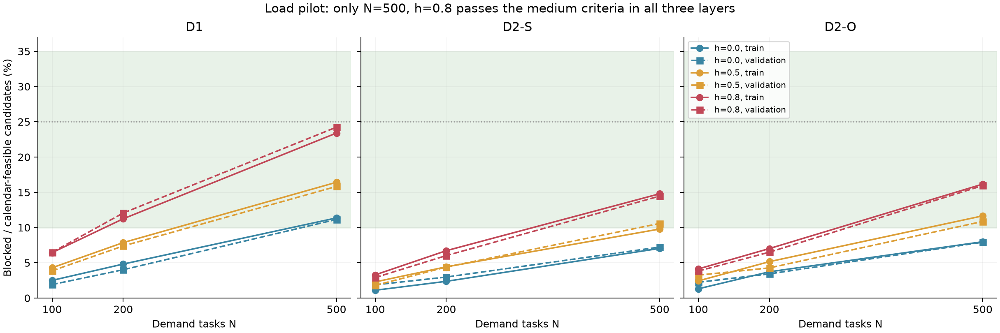
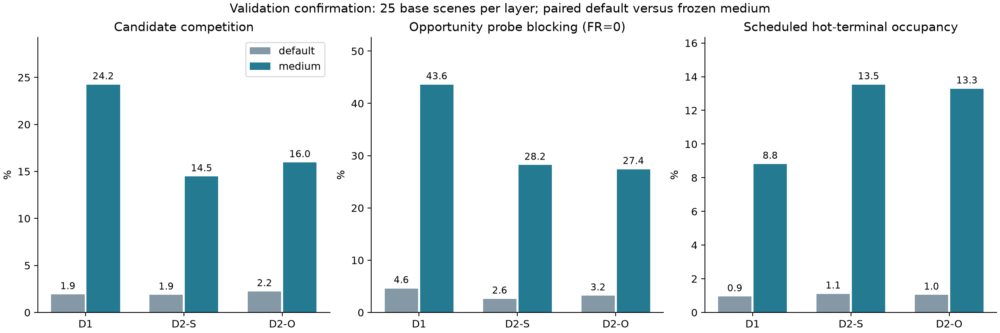

# 训练／验证负载试点报告：P1 补充，未进入 P3

本轮保留既有默认自然数据，完成预先冻结的 9 配置训练／验证负载试点。**新增中竞争层已通过并冻结：N=500、热点分支概率 h=0.8、每场景 4 颗热点星。高竞争层没有训练合格配置，未冻结。**没有运行修复算法、CP-SAT 或测试实例。

## 范围与预注册

批次：`LOAD-pilot-20261105T141600Z`。协议、实现和选层阈值先在 Git 提交 `8bffdc7` 固定；生成产物及选层在提交 `478aba8` 固定，随后执行独立审计。完整冻结协议见 `protocol/LOAD_PILOT_V1_CONTRACT.md`，运行配置见本批次 `config.json`。

复用原 P1 的 150 个场景，每层 25 训练＋25 验证；卫星、接触、轨道来源、片段及背景日历保持原值，不下载新快照。9 配置为任务数 100／200／500 × 热点概率 0／0.5／0.8。1,350 个上下文全部成功，训练 675、验证 675，生成失败 0；它们共享 150 个基础场景簇，不能当作 1,350 个独立样本。N100/h0 的 150 组任务与参考计划逐项重现原 P1。

同一 h 的需求是嵌套前缀；跨 h 保留任务 ID、数据量、速率、效用、名义窗长和抽样类别，热点分支改变端点与窗口锚点。热点星均匀无放回选取，不依据轨道度数或算法结果。背景忙概率仍为 0.5。h 是热点分支概率，不是实际热点端点份额。

## 指标与选层规则

竞争比例定义为“自身满足接触、任务窗和背景日历、但被固定参考计划阻塞的未排候选数／全部自身满足接触、任务窗和日历的候选数”，每组按 25 场景等权平均。日历、双方终端半双工、整数开始时刻和单窗口约束与原离散模型一致。

中竞争门槛为竞争比例 10%～35%、平均阻塞候选≥5、FR0 机会条件探针阻塞率≥10%；高竞争为 25%～70%、≥15、≥25%。共同要求物理机会比例≥65%、日历机会比例≥30%，二者相对默认下降均不超过 10 个百分点，每例 20 个机会条件探针；同一配置须在三个数据层同时通过。高层还须 N 不低于中层且每层竞争比例至少比中层高 10 个百分点。按 N 再 h 升序选择。

训练 675 个配置完成后、开始验证场景前保存 `training_selection.json`。中层只有 N500/h0.8 同时通过全部训练门槛。验证只确认此候选，三个数据层均通过；没有按验证结果改选。高层训练无人合格，最大配置在三层竞争比例仍低于 25%，且不能提供规定的中高间距。未放宽阈值、未扩展网格。

## 默认与新增层的竞争

| 划分 | 数据层 | 默认竞争比例 | 新增竞争比例 | 默认平均阻塞数 | 新增平均阻塞数 | 新增机会探针阻塞率 FR0 |
|---|---|---:|---:|---:|---:|---:|
| train | D1 | 2.50% | 23.40% | 1.16 | 56.32 | 41.80% |
| train | D2-S | 1.11% | 14.79% | 0.60 | 39.28 | 26.60% |
| train | D2-O | 1.31% | 16.16% | 0.72 | 43.12 | 32.60% |
| validation | D1 | 1.91% | 24.24% | 0.96 | 56.60 | 43.60% |
| validation | D2-S | 1.87% | 14.46% | 0.96 | 39.12 | 28.20% |
| validation | D2-O | 2.23% | 15.95% | 1.24 | 42.80 | 27.40% |

新增层的平均阻塞候选从约 1 个增至 39～57 个，验证的机会条件请求阻塞率为 27.4%～43.6%。这些是资源竞争诊断，不是修复服务成功率；候选池更大不证明实际预算 B 已绑定。



| N | h | 训练 D1 | 训练 D2-S | 训练 D2-O | 验证 D1 | 验证 D2-S | 验证 D2-O |
|---:|---:|---:|---:|---:|---:|---:|---:|
| 100 | 0.0 | 2.50% | 1.11% | 1.31% | 1.91% | 1.87% | 2.23% |
| 100 | 0.5 | 4.30% | 2.29% | 2.43% | 3.87% | 1.80% | 3.25% |
| 100 | 0.8 | 6.44% | 3.29% | 4.13% | 6.49% | 2.91% | 3.83% |
| 200 | 0.0 | 4.82% | 2.37% | 3.72% | 4.02% | 2.98% | 3.43% |
| 200 | 0.5 | 7.87% | 4.43% | 5.16% | 7.39% | 4.40% | 4.28% |
| 200 | 0.8 | 11.24% | 6.72% | 7.02% | 12.06% | 6.02% | 6.51% |
| 500 | 0.0 | 11.37% | 7.04% | 7.99% | 11.15% | 7.23% | 7.92% |
| 500 | 0.5 | 16.42% | 9.79% | 11.66% | 15.83% | 10.58% | 10.87% |
| 500 | 0.8 | 23.40% | 14.79% | 16.16% | 24.24% | 14.46% | 15.95% |

以上公开完整网格便于核验分布，验证网格未用于再次选层。

## 物理机会、日历与端点占用

| 划分 | 数据层 | 新增物理可行比例 | 新增日历可行比例 | 新增平均排入数 | 新增热点端点份额 | 新增热点终端计划占用 |
|---|---|---:|---:|---:|---:|---:|
| train | D1 | 80.94% | 47.91% | 183.24 | 44.47% | 9.37% |
| train | D2-S | 82.22% | 52.94% | 225.40 | 44.40% | 13.22% |
| train | D2-O | 82.26% | 53.26% | 223.16 | 44.50% | 12.88% |
| validation | D1 | 80.15% | 46.59% | 176.36 | 44.14% | 8.82% |
| validation | D2-S | 82.81% | 54.06% | 231.20 | 44.38% | 13.53% |
| validation | D2-O | 82.51% | 53.64% | 225.40 | 44.85% | 13.28% |

全终端计划占用约 2.8%～4.1%，热点终端约 8.8%～13.5%，均未包含背景日历占用。全时域平均占用仍不高，但有窗口的任务已产生可观的同端点局部竞争；不能以此宣称整个网络饱和。物理及日历机会没有因热点设置大幅减少，全部通过事先设置的退化门槛。



## 自然探针与机会条件探针分开解释

每配置分别生成 20 个原分布自然紧急探针和 20 个机会条件请求，并在 FR0/0.6 各诊断一次。自然探针沿用 release=0、deadline=600/120，不因其缺少物理机会而替换；机会条件请求从独立母序列后半段按顺序、只依据接触与日历资格选取，所有拒绝尝试保留。全部上下文均找到 20 个机会请求，未触及不足额门槛。

| 划分 | 数据层 | 类型 | 新增 FR | 无物理机会 | 日历阻塞 | 直接可插 | 可编辑阻塞 | 冻结阻塞 | 总数 |
|---|---|---|---:|---:|---:|---:|---:|---:|---:|
| train | D1 | natural | 0 | 415 | 40 | 38 | 7 | 0 | 500 |
| train | D1 | natural | 0.6 | 415 | 40 | 38 | 0 | 7 | 500 |
| train | D1 | opportunity | 0 | 0 | 0 | 291 | 209 | 0 | 500 |
| train | D1 | opportunity | 0.6 | 0 | 0 | 291 | 86 | 123 | 500 |
| train | D2-S | natural | 0 | 325 | 65 | 95 | 15 | 0 | 500 |
| train | D2-S | natural | 0.6 | 325 | 65 | 95 | 0 | 15 | 500 |
| train | D2-S | opportunity | 0 | 0 | 0 | 367 | 133 | 0 | 500 |
| train | D2-S | opportunity | 0.6 | 0 | 0 | 367 | 48 | 85 | 500 |
| train | D2-O | natural | 0 | 296 | 76 | 117 | 11 | 0 | 500 |
| train | D2-O | natural | 0.6 | 296 | 76 | 117 | 0 | 11 | 500 |
| train | D2-O | opportunity | 0 | 0 | 0 | 337 | 163 | 0 | 500 |
| train | D2-O | opportunity | 0.6 | 0 | 0 | 337 | 84 | 79 | 500 |
| validation | D1 | natural | 0 | 405 | 35 | 52 | 8 | 0 | 500 |
| validation | D1 | natural | 0.6 | 405 | 35 | 52 | 0 | 8 | 500 |
| validation | D1 | opportunity | 0 | 0 | 0 | 282 | 218 | 0 | 500 |
| validation | D1 | opportunity | 0.6 | 0 | 0 | 282 | 84 | 134 | 500 |
| validation | D2-S | natural | 0 | 311 | 73 | 103 | 13 | 0 | 500 |
| validation | D2-S | natural | 0.6 | 311 | 73 | 103 | 0 | 13 | 500 |
| validation | D2-S | opportunity | 0 | 0 | 0 | 359 | 141 | 0 | 500 |
| validation | D2-S | opportunity | 0.6 | 0 | 0 | 359 | 62 | 79 | 500 |
| validation | D2-O | natural | 0 | 303 | 80 | 105 | 12 | 0 | 500 |
| validation | D2-O | natural | 0.6 | 303 | 80 | 105 | 0 | 12 | 500 |
| validation | D2-O | opportunity | 0 | 0 | 0 | 363 | 137 | 0 | 500 |
| validation | D2-O | opportunity | 0.6 | 0 | 0 | 363 | 60 | 77 | 500 |

每格 500 探针是 25 基场景各 20 个，FR 两次以及不同 N/h 的共同探针不能重复计为独立自然事件。`probe_summary.csv` 另列默认层对应分母。自然请求中仍有大量无物理机会；本轮改善的是有机会任务之间的资源竞争，不能据此声称原自然紧急有效请求稀少的问题自动消失，也不能把机会条件请求当作自然紧急分布。

固定参考计划的最小同时冲突任务数按不同任务 ID 去重，双端重复只计一次。这表示固定位置插入需解除的阻塞，不等于允许联合移动后的最少删除数，不是全局不可行或最优证书。FR0.6 按精确 floor(0.6×原计划长度) 冻结原排序前缀。

## 审计、版本与复现

独立位集实现重建 1,350 个上下文，重放 360,000 个参考贪心决策，交叉核对 360,000 个候选诊断和 108,000 个探针×FR 标签，150 个默认计划与旧证据一致。任务生成、热点种子、探针接受／拒绝、逐上下文统计、训练选择和验证结果均复算。原 P2 及其补充、P1 当前验收维护清单的文件哈希全数保持原值。

本轮回归 188 项通过；P1 当前公开入口完整通过。原 P1 历史进度文档与 P2 当前版本的三项迁移仍由已有显式兼容协议核验，未修改旧验收。新增内容全部位于 experiment_runs，旧源码与数据未改写。来源归档 SHA-256：`7dab42a9fe806b74f41d529887a742e8cdec69fea9487745f280104209befeaa`。环境见 environment.json；运行的约 61 秒仅为离线生成与诊断，不是在线 50ms 性能证据。

从仓库根目录执行：

```powershell
experiment_runs/.venv/Scripts/python.exe experiment_runs/scripts/verify_load_pilot.py experiment_runs/reports/p1/LOAD-pilot-20261105T141600Z
experiment_runs/.venv/Scripts/python.exe experiment_runs/scripts/verify_load_pilot.py experiment_runs/reports/p1/LOAD-pilot-20261105T141600Z --full
```

第一条只读核验最终清单、来源、原产物和旧阶段证据；第二条在临时工作副本中重新执行完整位集审计，比较全部计数后自动清理副本，不覆盖任何公开回执。最终补充验收清单 acceptance_manifest.json 包含源码、报告、表格、图和审计证据哈希。

## 停点与适用范围

本轮按预定规则补足了跨三数据层可复核的中竞争负载条件；保留默认层作为自然基准，二者分别报告。高竞争层未通过，不宣称高负载机制覆盖完成。没有进入 P3，没有用修复性能反向选择数据，没有替换旧 P2 或 P2-C。后续是否另开高竞争试点、是否将新增中层纳入后续正式实验，应由用户决定；本轮不自动扩网格或启动下一阶段。
