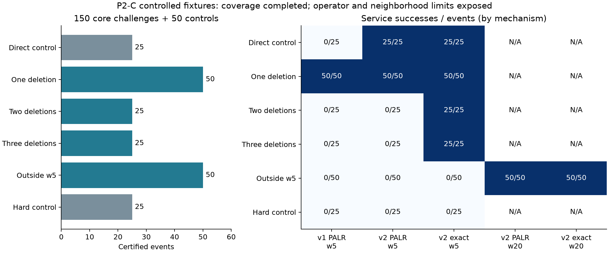

# P2-C：200 例受控紧急挑战实验报告

日期：2026-11-05。批次：`P2C-20261105T132557Z`（北京时间21:25:57开始）。范围：用户批准的 P2 补充，不启动 P3。

## 完成情况与结论

新增 200 例全部生成、取得类别证书、冻结并完成配对运行，无构造失败、类别未确认或替补。其中 **150 例核心修复挑战足额完成**：单项释放50、两项释放25、三项释放25、邻域外阻塞50；另有直接插入25和硬不可行25作对照。此计数独立于 PALR 成功或失败，不将可直接插入或无物理机会的事件计入核心挑战。

这解决了本轮**受控机制验证中有效挑战数量和指定类别覆盖不足**的问题。结果同时明确暴露方法边界：单项释放 PALR 成功50/50；必须释放两项和三项时，PALR分别0/25、0/25，而同域精确参照均可服务；邻域外阻塞50例在w5下不可服务，独立w20方法运行后PALR成功50/50。

200例是少数预先定义机制模板的参数变体，并不代表200种独立机制或真实轨道事件。不能将其服务率解释为自然紧急任务总体服务率，也不能声称一般场景覆盖或算法能力问题已经全部解决。

## 预注册、输入与方法版本

用户批准采用“新增200例P2-C，其中150例核心修复挑战”。协议和生成、认证、运行、审计源码在首次正式生成前提交：`03a25dc7e73c419ffdc96155288b36d23d540895`。协议见 [P2C_CONTRACT.md](../protocol/P2C_CONTRACT.md)。输入和类别证据冻结提交：`960c89dc9725db000ea47040a2c42dd3073e3919`；正式运行记录的源码提交即该提交。先认证并提交全部输入，再运行PALR。

输入目录：`p2/P2C-inputs-v1/`；结果目录：`p2/P2C-20261105T132557Z/`。旧P0/P1/P2、诊断、v2自然确认和52例旧压力样本均保留；原协议/状态/默认CLI不改，P2-C另设状态文件。

v1使用原`repair.py`/`p2_exact.py`，v2使用已批准的`repair_v2.py`/`p2_exact_v2.py`，本轮未改修复算子。v2仅本次紧急项豁免时间跨度资格。普通资格、原中心规则、冻结、E外承诺、双端冲突、日历、整数离散、预算定义均沿用。

每例8星、20个原任务，原参考计划由既有参考贪心构造且全部20项成功排入。所有任务时长满足`1+ceil(data_bits/rate_bps)`。接触、任务窗使用整数闭开区间，物理接触限制为唯一合法整数开始，以排除通过移动绕过删除下界的可能。紧急任务release=0，deadline为构造接触终点；这属于已公开的受控生成分布，**不沿用自然队列的deadline120/600分布**。horizon仍为5400秒。

采用PCG64种子210000至210199，对卫星标号置换、紧急开始40至200秒、紧急时长96至120秒、数据率1000/2000bit/s、效用及填充间隔做确定性变化。阻塞任务交替占用紧急发送端或接收端；两项/三项组以连续分区覆盖紧急占用区间。邻域组的阻塞任务从紧急开始前40秒开始并覆盖紧急区间，在其开始与紧急唯一开始之间排入14个异资源原任务，使该阻塞位于原索引w5之外、w20之内。

核心与直接组冻结数0，硬不可行对照中冻结组为1/20。背景日历包含异资源、不影响设计的占用；硬日历组另在紧急接收端设置全窗口占用。这个设计针对资源阻塞机制，不模拟广泛日历负载、宽窗口移动或多种冻结比例。硬对照按预定轮转为无物理接触9例、背景日历8例、冻结阻塞8例。

## 类别证据与验收

所有200个固定编号均仅生成一次，无静默重试或替补。输入`attempts.json`公开全部200次尝试；构造失败0、类别未确认0。方法表现不参与选择，硬不可行与控制事件不计入150个核心挑战。

独立整数开始枚举记录物理开始、日历阻塞、冻结/E外阻塞、每个可用开始需要释放的任务ID集合；同一原任务即使占用双方资源也只计一次。在本受控模板中，所有原任务都具有唯一开始，故该枚举可以与完整修复域的删除下界交叉核验。

另以既有v2完整局部精确模型进行强制接纳，保留同域内联合重排能力，对**全部原任务的删除数量**施加上界；不是仅统计某个插入位置的冲突数。

| 组别 | 数量 | 必须取得的类别证据 | 结果 |
|---|---:|---|---|
| 直接插入 | 25 | w5、删除上界0可行 | 25/25确认 |
| 单项释放 | 50 | w5上界0不可行、上界1可行 | 50/50确认 |
| 两项释放 | 25 | w5上界1不可行、上界2可行 | 25/25确认 |
| 三项释放 | 25 | w5上界2不可行、上界3可行 | 25/25确认 |
| 邻域外阻塞 | 50 | w5不可行；w20上界0不可行、上界1可行 | 50/50确认 |
| 硬不可行 | 25 | w20强制接纳仍不可行 | 25/25确认 |

类别探测单线程、每探测30s，未延长。400个认证探测状态为OPTIMAL175、INFEASIBLE225，无FEASIBLE/UNKNOWN。此处为清除目标后的满足性模型，OPTIMAL表示可行性探测完成；不可行结论只依据INFEASIBLE。每个可修复事件均保存强制服务的合法见证；邻域组见证对应w20。删除多项不增加新增预算计数：B仍按新接纳计数，不能将其解释为B扫描。

## 配对方法与预算

全部200例运行v1 PALR、v1精确参照、v2 PALR、v2精确参照，均w5/B2。邻域50例另运行v2 PALR w20和v2精确参照w20，总计900个方法观测（450启发式、450精确）。每事件方法顺序以PCG64种子220000打乱。

每次PALR预算50ms；每次精确参照总预算30s、单搜索线程，强制服务与回退共享该预算。w20是独立从原参考计划开始的50ms方法，**未将w5与w20串联为免费追加预算，也未实现或评估自动升级策略**。离线类别认证与在线方法耗时分开记录。

精确参照支持E内联合排程，PALR为现有插入/单项替换搜索；同域最优不意味着相同搜索能力，不能据服务结论一致声称PALR全局最优。

## 服务结果与原因

| 组别 | n | v1 PALR w5 | v1精确 w5 | v2 PALR w5 | v2精确 w5 | v2 PALR w20 | v2精确 w20 |
|---|---:|---:|---:|---:|---:|---:|---:|
| 直接插入 | 25 | 0 | 0 | 25 | 25 | 未运行 | 未运行 |
| 单项释放 | 50 | 50 | 50 | 50 | 50 | 未运行 | 未运行 |
| 两项释放 | 25 | 0 | 25 | 0 | 25 | 未运行 | 未运行 |
| 三项释放 | 25 | 0 | 25 | 0 | 25 | 未运行 | 未运行 |
| 邻域外阻塞 | 50 | 0 | 0 | 0 | 0 | 50 | 50 |
| 硬不可行 | 25 | 0 | 0 | 0 | 0 | 未运行 | 未运行 |

表中为服务成功数量；硬对照的0表示正确未接纳，不与可修复组混算“失败率”。邻域小域的0为该域不可行，也不等价于原问题全局不可行。直接组的v1失败来自资格过滤，因其E内任务全部晚于紧急截止；v2消除此限制后全部直接接纳。

单项释放50例均完成1次删除与1次新增，移动量0。两项/三项释放的PALR均保留原计划、未接纳，精确参照分别删除2/3项并新增紧急项，移动量0。邻域组w20的PALR和精确参照均删除1项、新增1项、移动量0，w5保持原计划。硬对照没有违规接纳。各组效用均值和逐事件指标见`summary.json`、`per_event_detailed.csv`。

不能从这些固定机制比例推断总体PALR服务率。它们的主要作用是区分：资格不足可由v2修正；算子无法联合释放两项/三项；小邻域的E外承诺可能阻止修复，而独立扩大邻域在本组恢复服务。



## 超时、校验与精确状态

全部900个输出计划通过既有独立校验器及同域见证检查，包括窗口、双端资源、日历、冻结、E外承诺与累计新增预算；无约束违规。450次PALR中有1次超时：`case-183.json`，硬不可行冻结对照，v2 PALR w5总耗时50.395ms。其返回原参考计划有效、没有违规接纳，但`valid_output=false`、`online_success=false`，不将可行计划当作按时输出。该条保留原记录，不重跑替换。其他PALR均在50ms内，所有核心挑战运行均无超时。

450次最终精确结果均OPTIMAL；原生方法阶段625个，状态OPTIMAL450、INFEASIBLE175。最终回退OPTIMAL不代表紧急任务可服务；服务子问题与回退分开记录。无FEASIBLE/UNKNOWN，无精确事件总耗时超过30s，最大总耗时约340.754ms。

独立审计完成：200例按种子全部重建并逐字节核对；200例的两种邻域标签全部重算；400个类别模型与625个方法模型及原生响应全部核对且重新求解，总计 **1025个模型实际重放**。模型状态和已优化模型的目标/界与归档一致。175个类别可行见证另行校验，900个方法计划全部校验。原生响应和重放属于可复核CP-SAT证据，并非DRAT等外部形式证明。

回归测试 **171项全部通过**，新增15项包括双项/三项完整域删除下界、同中心邻域改变、硬对照宽域不可行及确定性构造。原P2、诊断、自然补充的所有已验收文件哈希保持一致；其验收清单哈希也保存于本轮审计中。

## 环境、时延与限制

Windows 11、CPython3.14.0、OR-Tools9.15.6755，Intel Core Ultra 5 125H，完整版本与依赖见环境文件及冻结lock。进程亲和性mask=1，OMP/OpenBLAS/MKL/NumExpr线程变量均1，CP-SAT workers=1。频率和OS调度不受控；本次计时为本机描述，不替代Linux主性能基准，不作速度显著性推断。

| 方法 | 观测数 | 平均ms | P95 ms | 最大ms |
|---|---:|---:|---:|---:|
| v1 PALR w5 | 200 | 6.974 | 20.615 | 42.092 |
| v2 PALR w5 | 200 | 7.845 | 18.712 | 50.395 |
| v2 PALR w20（仅邻域组） | 50 | 12.714 | 24.874 | 32.959 |

样本的唯一开始、强阻塞和少数模板是有意的控制条件，会让类别清晰，也限制自然代表性。不同seed的标号、时间、效用变体不能当作新的独立结构；不对这些重复模板做自然总体置信区间或P6统计推断。既有自然200例仍然有160例无物理机会，这个自然分布特征并没有被受控组改变。当前结论是指定机制的样本覆盖验收通过，不是所有实际紧急挑战都已充分覆盖。

## 追溯与复核

- `p2/P2C-inputs-v1/manifest.json`：构造源码、全部输入与类别证据哈希。
- `p2/P2C-inputs-v1/selected.json`：每个样本参数、整数枚举标签、类别状态和见证。
- `p2/P2C-inputs-v1/category_models.zip`：类别模型与响应。
- `p2/P2C-20261105T132557Z/manifest.json`：正式方法原始观测与源码哈希。
- `results.jsonl`、`solver_artifacts.zip`：方法顺序、计划、指标、计时、原生模型/响应/统计。
- `independent_audit.json`：全部1025模型重放及原验收哈希保护。
- `summary.json`、`analysis.json`、`per_event_detailed.csv`：按组指标、时延、超时与完整逐方法服务字段。旧`per_event.csv`保留原摘要输出，精确方法的服务字段以详细CSV为准。
- `acceptance_manifest.json`：本轮最终完整哈希及验收结果。

在仓库根目录复核：

```powershell
experiment_runs/.venv/Scripts/python.exe -m pytest experiment_runs/tests -q
experiment_runs/.venv/Scripts/python.exe experiment_runs/scripts/verify_p2c.py experiment_runs/reports/p2/P2C-20261105T132557Z --replay
```

只核对哈希和已有审计时省略`--replay`。带`--replay`时在临时副本中重放全部模型，并核对审计摘要与原记录一致，原目录不写入。生成入口为`p2c_study.py prepare`（固定输入目录已存在则拒绝覆盖），执行入口为`p2c_study.py run`（新批次目录），派生分析入口为`p2c_analysis.py`。

## 当前停点

P2-C的200例、150核心、逐组类别、方法比较和独立复核均完成。受控挑战数量不足已按批准设计补齐；现有PALR联合释放能力不足被明确验证，未擅自修改算法。w20结果是固定参数对照，未扩展为自适应升级。P3未启动；后续阶段与方法版本变更由用户决定。
