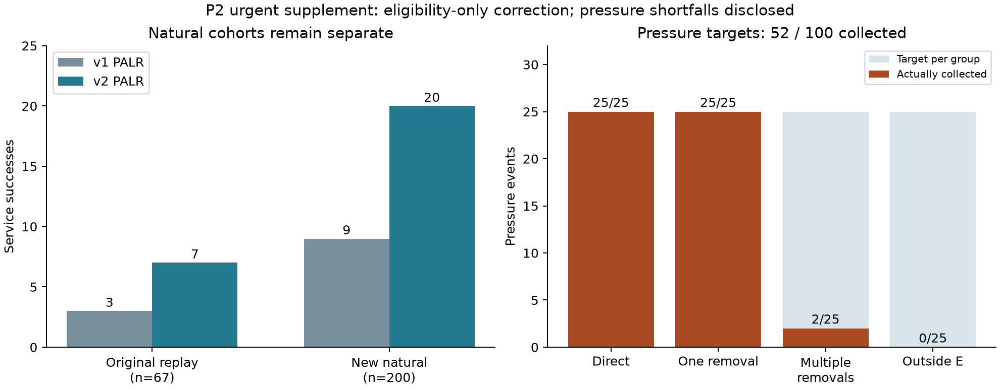
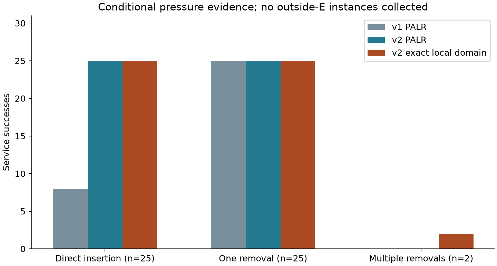

# P2 紧急规则 v2 与独立压力组补充报告

日期：2026-11-05。性质：P2 补充；P3 未启动。执行批次：`P2-urgent-supplement-20261105T123731Z`。

## 结论与完成范围

用户已确认的 A 项完成：仅豁免本次紧急任务的时间跨度资格，完成原 67 例回放以及新 200 例自然紧急事件的 v1/v2 配对确认。新自然集 PALR 服务成功由 9/200 增至 20/200，新增 11 例、无服务退化，无超时。两版本各自的精确局部服务结论与 PALR 在该自然集上一致，但不能据此推断全局最优或一般紧急请求可行率。

B 项已按批准的固定种子与每组最多 5000 尝试规则执行并停止，但 **100 例目标未达成，仅获得 52 例，缺 48 例**。直接插入与单项释放各 25 例，多项释放 2 例，邻域外阻塞 0 例。未更换种子、放宽分布、移动窗口或延长尝试上限。两个多项释放案例均为精确模型可服务而 PALR 未接纳，揭示了单项替换算子的能力边界；邻域外阻塞没有取得实验样本，不能作效果结论。

原 P0/P1/P2 数据、源码及验收证据未覆盖。全部新增文件位于 `experiment_runs/`，历史状态文件保持不动，补充状态单独记录于 `urgent_supplement_status.json`。

## 诊断依据和版本语义

前序诊断见 [P2_URGENT_DIAGNOSTIC_REPORT.md](P2_URGENT_DIAGNOSTIC_REPORT.md)。原 67 例中，52 例无物理窗口、8 例被背景日历阻塞，7 例在局部资源约束下可服务。原先被资格排除的 61 例实际分为 49 例无物理窗口、8 例日历阻塞、4 例仅因资格过滤失败。因此，**资格过滤的可避免失败是 4 例，不能将 61 例全部解释为过滤造成的失败**。其余原本有资格的 6 例中有 3 例无物理机会、3 例可服务。

批准的协议见 [P2_URGENT_SUPPLEMENT_CONTRACT.md](../protocol/P2_URGENT_SUPPLEMENT_CONTRACT.md)。v1 继续使用原 `repair.py` 和 `p2_exact.py`，原 CLI 默认行为不变；v2 使用明确命名的 `repair_v2.py` 与 `p2_exact_v2.py`。唯一方法规则变化为本次紧急项不受 E 时间跨度资格限制。普通任务资格、邻域中心、E、E 外计划、冻结、收发双端冲突、背景日历、离散整数开始及预算均保持原定义。

共同配置为 w=5、B=2。PALR 每事件 50 ms，CP-SAT 每事件总上限 30 s、单搜索线程；强制服务探测与回退共享事件时限。精确域允许 E 内联合重排，PALR 的插入/单项替换并不拥有同样的搜索能力。精确证书只支持指定局部域和对应资格版本内的结论。

## 输入冻结与自然确认集

输入先冻结，再执行算法。协议源码提交：`0a840a7bfaf0dd01e7c2d8217fc3197a2fc0ffd7`；输入冻结及正式求解源码提交：`02710ee7c1dcede9b61c1141b13f38e1ba99ee9a`。输入目录为 `p2/P2-urgent-supplement-inputs-v1/`，正式结果目录为 `p2/P2-urgent-supplement-20261105T123731Z/`。

六个规模组合（候选数 10/20/30 × 卫星数 4/8）各生成 50 个有效且参考计划非空的基实例，共 300 个。按组合顺序的总尝试数为 73/50/70/50/81/50，共 374 次，74 次结构失败或空参考均公开。按固定 PCG64 顺序选择 34/34/33/33/33/33 个基实例，总计 200 个不同基实例；未选的 100 个保留但不运行事件。全部选择事件为紧急事件，FR/q 四场景轮转；不按算法成功、失败或效用补采样。

自然基实例种子为 `150000+1000*组合编号+尝试编号`，选择种子 160000，事件种子从 161000 开始；方法执行顺序种子 162000。压力组独立种子流为 `170000+5000*组编号+尝试编号`。确切编号约定、事件种子派生、参数和所有尝试见配置、输入清单及生成脚本。不读取或生成 P3 测试表现。

## 三个队列分别报告

| 队列 | 事件数 | v1 PALR 服务 | v2 PALR 服务 | v1 精确可服务 | v2 精确可服务 | 配对新增/退化 |
|---|---:|---:|---:|---:|---:|---:|
| 原 P2 回放（诊断） | 67 | 3 | 7 | 3 | 7 | 4 / 0 |
| 新自然确认集 | 200 | 9 | 20 | 9 | 20 | 11 / 0 |
| 有条件压力样本 | 52 | 33 | 50 | 35 | 52 | 17 / 0 |

自然集的样本服务比例由 4.5% 到 10.0%，增加 5.5 个百分点。分层诊断为：无物理机会 160、背景日历阻塞 17、冻结阻塞 3、可直接插入 19、需要单项释放 1。也就是说，新自然集仍以无物理服务机会的请求为主；资格修订清除了可避免的局部过滤，但没有使它成为高强度资源竞争样本。

原 67 例仅用于回放和诊断，不与新 200 例合并为确认分母；有条件压力样本也不并入自然服务率。服务接纳一致不等于完整字典序目标一致，逐事件效用、删除/新增/移动及完整目标对比已保存在 `results.jsonl` 和 `per_event_comparison.csv`。本补充不作 P6 的总体统计推断。



## 压力组：停止规则、结果与不足

每组独立生成 30 候选、8 卫星的事件，保留 P1 D1 分布、release=0、deadline=120/600 s。先用物理窗口、背景日历、冻结、E 外占用和整数开始枚举分类，不使用 PALR 表现选择。冲突的同一原任务即使占用收发两端也只计一次。w=5 的最小需移除任务数为 0/1/至少 2 分别对应前三组；w=5 不可服务而 w=20 可服务为第四组。

| 目标类别 | 生成尝试 | 实际/目标 | 缺口 | v1 PALR 服务 | v2 PALR 服务 | v2 精确可服务 |
|---|---:|---:|---:|---:|---:|---:|
| 直接插入 | 246 | 25/25 | 0 | 8/25 | 25/25 | 25/25 |
| 单项释放 | 4558 | 25/25 | 0 | 25/25 | 25/25 | 25/25 |
| 多项释放 | 5000 | 2/25 | 23 | 0/2 | 0/2 | 2/2 |
| 邻域外阻塞 | 5000 | 0/25 | 25 | 无样本 | 无样本 | 无样本 |
| 合计 | 14804 | 52/100 | 48 | 33/52 | 50/52 | 52/52 |

所有失败、拒收及尝试分母均保存于 `pressure_generation_attempts.json`。两项释放样本为 `pressure-g2-000.json`（seed 181112）和 `pressure-g2-001.json`（seed 183765），均为 FR=0，q 分别 0.2、0.8，最小需移除任务数均为 2。它们提供算子边界的具体反例，但 n=2 无法支撑此类困难的总体发生频率结论。新增预算 B 统计新接纳任务，不能将两项移除解释成 B 扫描。

邻域外阻塞组为空，故没有实际 w=20 对照结果，更不能宣称已验证邻域扩展或自动升级策略。若需要补足 48 例，应另行预注册改变生成分布或受控构造的新设计，独立编号，经用户确认后实施；当前批次不能悄悄追加筛选。



## 验证、精确状态与环境

回归测试 156 项全部通过，含新增的资格豁免、普通项资格不变、冻结/E 外/日历/B=0 不可绕过、双端同一任务去重和压力类别边界测试。

319 个事件 × 4 个方法版本输出共 1276 个计划通过独立可行性与预算检查。638 次最终精确求解全部 OPTIMAL；连同强制服务与回退子问题，原生阶段共 1150 个模型，状态为 OPTIMAL 638、INFEASIBLE 512，无 FEASIBLE/UNKNOWN。最终回退问题为 OPTIMAL 不代表紧急服务可行，服务子问题状态单独保存。所有 1150 个模型/原生响应经检查并实际重放；OPTIMAL 的目标与界一致，INFEASIBLE 由相同离散模型的原生求解状态支持。归档为可重放的 CP-SAT 原生证据，并非独立形式证明系统的外部证明文件。

审计另以独立位掩码实现重算全部 319 例标签；重新生成全部 374 个自然尝试和全部 52 个接收的压力尝试，按每组 100 个抽查重建共 400 个拒收压力尝试；全部 14804 个压力尝试的元数据序列、停止规则与选择记录经过核对。**没有声称重新生成全部 14804 个压力尝试。** 原 P2 验收清单全部哈希保持一致。

运行环境 Windows 11、CPython 3.14.0、OR-Tools 9.15.6755，完整依赖与环境在 `environment.json`、冻结 lock 中。正式运行进程设置单逻辑处理器亲和性，底层线程环境变量设为 1；环境捕获中通用 `threading_note` 为旧模板文字，实际亲和性以同文件 actual_affinity 记录为准，线程环境设置见冻结的运行脚本第 3 行。CPU 频率未控制。本次无 PALR 50 ms 超时，无精确总耗时超过 30 s。新自然集 v1/v2 PALR 平均耗时约 3.911/3.770 ms，最大 34.421/18.319 ms；压力组 v2 最大约 45.497 ms。上述仅为本机描述性计时，不替代方案要求的 Linux 正式性能实验，也不作速度显著性或实时保证。

## 文件与复核入口

- 输入哈希：`P2-urgent-supplement-inputs-v1/manifest.json`；完整源文件/ZIP 条目哈希均在其中。
- 正式运行哈希：`P2-urgent-supplement-20261105T123731Z/manifest.json`；输入清单 SHA-256 为 `f11458b146b0fb86efa854d8e1ce3c9a3ce3eaeff6d3f23b3d780a7df3f58c3e`。
- `independent_audit.json`：独立审计和模型重放摘要；`solver_artifacts.zip`：原生模型、响应、日志。
- `analysis.json`、`per_event_comparison.csv`：分层、逐事件目标与耗时；`pytest.xml`/`pytest.txt`：测试证据。
- `acceptance_manifest.json`：本补充的最终文件哈希与完成/不足状态。

在仓库根目录使用已安装冻结依赖的 Python 复核（复核既有记录时不加 `--write-audit`，避免覆盖审计）：

```powershell
experiment_runs/.venv/Scripts/python.exe -m pytest experiment_runs/tests -q
experiment_runs/.venv/Scripts/python.exe experiment_runs/scripts/verify_urgent_supplement.py experiment_runs/reports/p2/P2-urgent-supplement-20261105T123731Z --replay-solvers
```

生成/执行入口分别为 `prepare_urgent_supplement.py`、`run_urgent_supplement.py`，摘要入口为 `summarize_urgent_supplement.py`。冻结目录具有拒绝覆盖保护，复现实验应使用独立新目录，不能替换本批次证据。

## 当前停点

A 项及 B 项预定上限内执行、公开和复核已结束；B 项数量验收明确未达标。资格规则造成的可避免失败得到修正并通过新自然集确认，但复杂资源竞争与邻域外机制的证据仍不足。P3 及后续实验均未启动；后续阶段及压力生成协议变更由用户决定。
